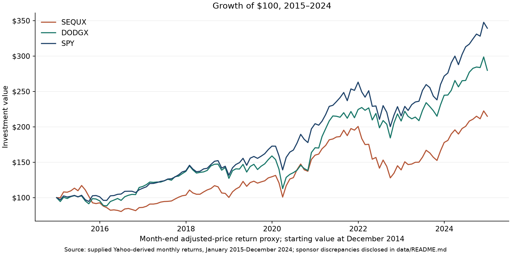
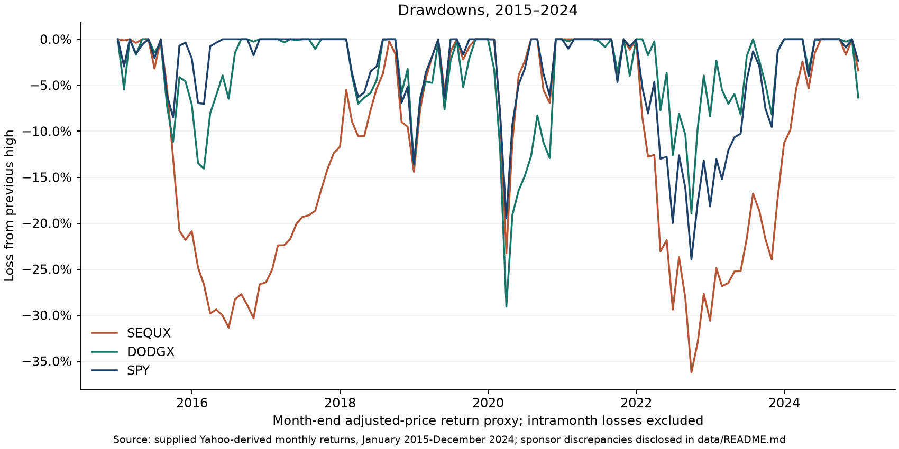
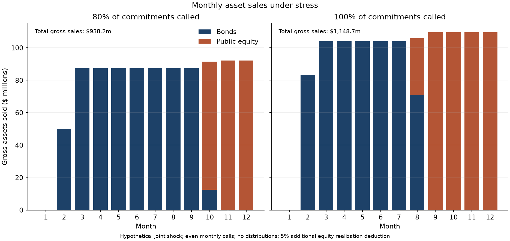

# Endowment Allocation & Manager Evaluation Study

**Independent historical case | January 2015-December 2024**

Would a hypothetical $5 billion endowment have sufficient evidence to replace part of a passive US-equity allocation with Sequoia Fund (SEQUX) or Dodge & Cox Stock Fund Class I (DODGX)?

The study compares 120 monthly returns, evaluates illustrative allocation effects, and runs a separate 12-month funding stress. The case decision is to **retain passive exposure pending further research**. Both funds lagged SPY in the supplied sample, but Dodge & Cox exceeded its sponsor-reported value benchmark over ten years. SPY measures the funding alternative; a manager assessment also requires style, team and implementation evidence.

Start with the [investment-committee-style memo](IC_MEMO.md). This is a preliminary public-data case, with hypothetical allocations and funding assumptions. No actual endowment assets are managed, and no factor regression or full manager due diligence is claimed.



## Reproduce the supplied-input analysis

Python 3.14 was used for verification. The two direct dependencies are pinned in requirements.txt.

Windows PowerShell:

```powershell
py -3.14 -m venv .venv
.\.venv\Scripts\python.exe -m pip install -r requirements.txt
.\.venv\Scripts\python.exe analyze.py
.\.venv\Scripts\python.exe verify.py
```

macOS/Linux:

```bash
python3.14 -m venv .venv
.venv/bin/python -m pip install -r requirements.txt
.venv/bin/python analyze.py
.venv/bin/python verify.py
```

Installation needs internet access. Afterwards, analysis and checks run offline using three supplied input tables. The scripts generate seven result CSVs, three charts and the memo. The code in analyze.py is the source of scenario assumptions; this README describes the shipped case. The generated memo reads current assumptions and results. Changes to the data or policy still require reviewing the stated investment judgment.

## Historical fund comparison

CAGR, annualized sample volatility, maximum month-end drawdown and correlation are calculated from monthly adjusted-price return proxies. Fund operating expenses are embedded; dividends and contemporary expense ratios are not counted again. Drawdowns include the initial investment as a possible peak. February-March 2020 and calendar 2022 are selected windows, not a comprehensive regime model.

SPY is the investment being reduced. Dodge & Cox's sponsor reports ten-year returns of **10.85% for DODGX Class I versus 8.49% for Russell 1000 Value** through December 2024. That context warrants separating the decision to allocate to value from manager implementation. It does not establish alpha. [Source, page 6](https://www.dodgeandcox.com/content/dam/dc/us/en/pdf/podcast/2024_Annual_U.S._Equity_Review_Presentation.pdf). Sponsor context is stored separately from the vendor series in data/benchmark_context.csv; a matched monthly style comparison remains future research.

Manager weights of 0%, 2.5% and 5% of NAV replace SPY within the initial 20% US-equity budget. A 5% position is $250 million, or 25% of that budget. The weights are scenarios, not optimized sizes. Fund holdings can change underlying geographic exposure even if the policy budget is unchanged.

```text
monthly incremental contribution = weight * (fund return - SPY return)
annualized arithmetic contribution = 12 * average monthly contribution
```

The calculation assumes constant weights and no rebalancing costs. Its result is an arithmetic contribution, not a compounded whole-endowment return or a complete portfolio-risk assessment.



## Funding stress: assumptions and purpose

| Assumption in shipped case | Reason and interpretation |
|---|---|
| $5bn starting NAV; 20% US equity, 10% international equity, 15% bonds, 15% hedge funds, 35% private markets, 5% cash | Illustrative balanced set of liquid and locked assets; not a named institution's policy. |
| Fixed $250m annual spending, paid monthly | Equals 5% of beginning NAV and remains fixed after the loss to represent near-term budget rigidity. No smoothed spending rule or universal requirement is assumed. |
| $1bn opening unfunded commitments | A commitment stock, equal to 20% of initial NAV; distinct from invested private NAV and annual pacing. |
| 80% and 100% called over the year | Deliberately severe rapid-draw cases without offsetting distributions; not estimated normal call rates or probabilities. |
| $125m soft cash target | Six months of ordinary spending, but only about 1.43 months of combined spending/calls in the 80% case. Obligations take priority. |
| Immediate losses: equity 50%, bonds 10%, hedge funds 25%, private markets 40% | Constructed joint shock, not a replay of one historical crisis or a probability estimate. |
| Bonds sold first; no additional bond deduction | Explicit liquidation convention. Bond duration, credit quality and trading frictions are not separately modeled. |
| Additional 5% equity realization deduction after the market loss | An adverse realization sensitivity, not an assertion about ordinary public-fund trading costs. Alternatives of 0% and 1% are reported. The bond/equity cost asymmetry is a simplification. |
| Even monthly calls; no distributions or later returns | Transparent cash-budget schedule. A front-loaded alternative tests timing. No later returns excludes both further losses and recoveries. |
| No borrowing, hedge-fund redemptions or private-asset sales | Constrained funding test; real notice periods, facilities, restrictions and gates would require separate diligence. |

Calls transfer cash into private NAV at par and reduce commitments; spending and realization losses reduce NAV. Calls with fee components, valuation lags, vintage-level pacing, default penalties and settlement delays are omitted. The stress applies the same public-equity loss regardless of manager, so it cannot rank managers' liquidity or downside protection.

## What the shipped case shows

The 80% call case requires **$938.2m total gross asset sales: $675.0m bonds plus $263.2m public equity**. The equity deduction causes $13.2m of additional NAV loss. All obligations are paid, with $125m ending cash and private assets at 61.17% of ending NAV.

```text
Gross equity sales ($m) = (250 spending + 800 calls + 125 reserve
                          - 250 opening cash - 675 bond proceeds) / 0.95
                        = 263.157895
Gross total sales ($m) = 675 + 263.157895 = 938.157895
```

Maintaining the reserve accounts for half of those gross equity sales: with no cash target, equity sales fall to $131.6m. Calling 100% produces $1,148.7m total gross sales and a 68.02% ending private weight. Both cases exhaust bonds. Neither defaults under the modeled assumptions; the result is the portfolio consequence of funding obligations, not a forecast of a liquidity failure.

The [generated memo](IC_MEMO.md) and [sensitivity table](results/liquidity_sensitivities.csv) show lower call rates, reserve choices, realization deductions and front-loaded calls. The memo also reports remaining liquid assets and commitments. A positive cash balance alone is insufficient evidence of future flexibility.



## Sources and limits

[Data documentation](data/README.md) distinguishes observed inputs, sponsor checkpoints and benchmark context. Hashes detect changes to supplied files; they do not establish economic accuracy. Two differences remain unexplained: SEQUX ten-year CAGR is about 6.55 bp below its sponsor figure; DODGX's vendor 2024 return is about 15.94 bp below the sponsor figure. No matched archived SPY sponsor checkpoint is verified. Returns are retained unchanged.

Outputs reproduce from the supplied CSVs. [prepare_data.py](prepare_data.py) provides a hash-checked route from original Yahoo JSON files to candidate monthly returns and selected-date diagnostics. Original-vintage files are absent, so that reconstruction has not been demonstrated for the published inputs. The script writes candidates separately and does not silently replace the analysis dataset.

The sample contains selected surviving funds and data retrieved after the research window. Team changes, endpoint selection, monthly sampling and benchmark fit limit inference. SEQUX is the historical Sequoia mutual fund, distinct from the Sequoia venture-capital firm. Its sponsor reports an ETF successor beginning October 16, 2026; this case does not evaluate current vehicle terms. [Sponsor disclosure](https://www.sequoiaetf.com/sequoia-etf-performance/).

Before an actual hire, evaluate a matched style alternative, team continuity, process, holdings, fees, eligible vehicle, capacity and operations, and the role in the whole portfolio. The present analysis does not complete those tasks.

## Files

- analyze.py: financial calculations, charts and scenario assumptions.
- reporting.py: memo generated from current assumptions and results.
- verify.py: return, source, accounting, sensitivity and reporting checks.
- prepare_data.py: optional original-raw reconstruction and diagnostics.
- data/: three input tables and provenance.
- results/: seven CSVs and three charts.
- [LEARNING_GUIDE.md](LEARNING_GUIDE.md): optional worked examples.

Rates in CSVs are decimals; dollar values are US dollars. Third-party data and publications retain their owners' rights. Their citation or presence in a source register does not grant redistribution rights.
